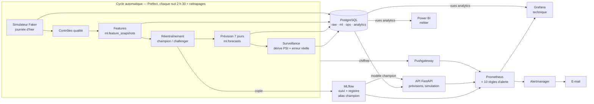

# SmartSupply AI

**Prévision de la demande et du risque de rupture de stock — Data Engineering, Power BI, Machine Learning et MLOps, de bout en bout.**

[](https://github.com/Elie224/smartsupply/actions/workflows/ci.yml)

🌐 **Site public (mis à jour chaque nuit) : https://smartsupply-bmltwzqdengm24263gay2v.streamlit.app**

> **Données 100 % synthétiques.** Faker fabrique les identités (clients, produits, fournisseurs) ; un simulateur métier fabrique l'activité (commandes, stocks, achats, promotions, arrivées et départs de clients). Les résultats sont valables **dans ce monde simulé** et ne constituent pas une validation sur une entreprise réelle.

Le système tourne **tout seul, chaque nuit**, sur le calendrier réel : il simule la journée d'hier, contrôle les données, réentraîne le modèle (et ne le met en service que s'il est meilleur), prévoit la demande des 7 prochains jours, surveille la dérive et l'erreur réelle, et prévient par e-mail en cas de problème.

| | |
|---|---|
| Historique | 01/01/2024 → hier, **≈ 255 000 commandes**, 50 produits, 3 entrepôts, ≈ 1 200 clients (dont ~200 arrivés en cours de route) |
| Modèle | **LightGBM**, demande totale à 7 jours par produit |
| Erreur (test final, jamais vu) | **13,5 %** de WAPE contre **18,1 %** pour la meilleure méthode naïve (**−25 %**), biais +0,7 % |
| Erreur du modèle en service | **12,4 %** sur les 8 dernières semaines (naïve : 19,1 %) |
| Contrôle | `python -m smartsupply.verify` : **29 points**, tous verts |
| Tests | **132 tests** (pytest), dont l'absence de fuite d'information future ; tests unitaires rejoués par GitHub Actions à chaque push |

---

## 1. Ce que le système apporte

| Question métier | Où trouver la réponse |
|---|---|
| Quels produits risquent de manquer dans les 7 jours ? | Power BI « Prévisions », API `GET /previsions?alerte=rupture probable` |
| Combien va-t-on vendre la semaine prochaine ? | Power BI « Prévisions », API `GET /previsions/{id}` |
| Quel effet aurait une promotion de 20 % ? | API `POST /simuler` |
| Quels clients sont les meilleurs, en baisse, perdus ? | Power BI « Clients » |
| Le modèle reste-t-il bon ? Les données changent-elles ? | Grafana « Modèle », MLflow, e-mail d'alerte |
| Le nouveau modèle est-il meilleur que l'ancien ? | MLflow (chaque entraînement, retenu ou refusé, avec la raison) |

---

## 2. Architecture



**Principes :**
- **PostgreSQL est la référence.** Power BI et le ML lisent la base ; le ML y réécrit ses prévisions, que Power BI affiche. MLflow est le miroir consultable des entraînements et le registre d'où l'API charge le modèle.
- **Lecture seule partout où c'est possible** : Power BI (`powerbi_reader`) et Grafana (`grafana_reader`) ne voient que le schéma `analytics`.
- **Rien ne casse en cascade** : si MLflow, le Pushgateway ou Alertmanager sont arrêtés, le cycle continue et rattrape au passage suivant ; l'API se rabat sur la base.

Détails : [docs/architecture.md](docs/architecture.md).

---

## 3. Services et adresses

Tout tourne en local dans Docker (`docker compose`), uniquement sur `127.0.0.1`.

| Service | Rôle | Adresse |
|---|---|---|
| PostgreSQL 16 | Données brutes, features, prévisions, journal | `127.0.0.1:15432` |
| Prefect 3 | Orchestration du cycle | http://127.0.0.1:14200 |
| pipeline | Le cycle lui-même (flow Prefect `cycle-nocturne`) | — |
| MLflow 3.18 | Suivi des entraînements, registre des modèles | http://127.0.0.1:15000 |
| API (FastAPI) | Prévisions et simulation, modèle champion | http://127.0.0.1:18800/docs |
| Prometheus 3.13 | Mesures techniques, règles d'alerte | http://127.0.0.1:19090 |
| Pushgateway | Boîte de dépôt des chiffres du cycle | http://127.0.0.1:19091 |
| Alertmanager | Envoi des alertes par e-mail | http://127.0.0.1:19093 |
| Grafana 13 | Tableaux de bord techniques | http://127.0.0.1:19300 |
| postgres-exporter | État de PostgreSQL pour Prometheus | — |
| Power BI Desktop | Tableaux de bord métier (`dashboards/powerbi/smartsupply.pbix`) | — |

---

## 4. Démarrer de zéro

**Prérequis :** Docker Desktop, Python 3.12 (un environnement conda ou venv), Power BI Desktop (facultatif).

```powershell
# 0) Configuration : copier l'exemple puis remplir mots de passe, e-mail, etc.
copy .env.example .env
notepad .env
python -m pip install -e ".[dev]"

# 1) Base de données
docker compose up -d postgres
docker compose exec postgres psql -U smartsupply -d smartsupply -f /database/schema.sql
docker compose exec postgres psql -U smartsupply -d smartsupply -f /database/analytics_views.sql
docker compose exec postgres psql -U smartsupply -d smartsupply -v reader_password='...' -f /database/roles.sql
docker compose exec postgres psql -U smartsupply -d smartsupply -v grafana_password='...' -f /database/roles_grafana.sql

# 2) Données : référentiel puis historique jusqu'à hier (≈ 1 h, relançable sans doublon)
python -m smartsupply.generator.reference_data
python -m smartsupply.generator.bootstrap

# 3) Dataset ML, premier modèle et première prévision
python -m smartsupply.features.build
python -m smartsupply.models.nightly

# 4) Tous les services (le cycle prend ensuite le relais chaque nuit)
docker compose build
docker compose up -d

# 5) Alerte Windows du matin (facultatif) puis vérification complète
powershell -ExecutionPolicy Bypass -File .\scripts\install_alert.ps1 -Python (Get-Command python).Source
python -m smartsupply.verify
```

`verify` contrôle 29 points (conteneurs, base, données, modèle, prévision, surveillance, Prefect, MLflow, Prometheus, alertes, Grafana, API) et donne **la commande de correction** pour chaque problème.

Problèmes connus (veille du PC, mémoire, ports déjà pris…) : [docs/runbook.md](docs/runbook.md).

---

## 5. Le cycle automatique

Flow Prefect `cycle-nocturne`, déploiement `chaque-nuit` : **2 h 30** (heure de Paris), puis **rattrapages** à 8 h 15, 11 h 15, 14 h 15, 17 h 15, 20 h 15 et 23 h 15. Un passage sans travail ne prend qu'une seconde. Au démarrage du conteneur, un passage immédiat rattrape le retard (PC éteint la nuit).

| Étape | Ce qu'elle fait |
|---|---|
| 1. Simulation | Simule les journées **terminées** manquantes (jamais de date future ; une journée est écrite en entier ou pas du tout) |
| 2. Qualité | 6 contrôles : soldes de stock égaux au journal des mouvements, aucun stock négatif, jours consécutifs, commandes après l'inscription du client, quantités cohérentes (demandé = servi + perdu), réceptions après commande ; le cycle s'arrête si un contrôle échoue |
| 3. Features | Met à jour `ml.feature_snapshots` (règle anti-fuite : rien d'après la date D) |
| 4. Réentraînement | Nouveau modèle évalué sur les **8 dernières semaines** non vues ; **mis en service seulement s'il bat la méthode naïve, a un biais ≤ 5 % et n'est pas plus mauvais que le modèle en place** (tolérance 1 point) |
| 5. Prévision | Demande des 7 prochains jours pour chaque produit, enregistrée **sans jamais être modifiée** ensuite |
| 6. Surveillance | Dérive (PSI) des 20 variables du modèle ; erreur réelle des prévisions dont les 7 jours sont écoulés |
| 7. MLflow | Recopie entraînements, modèle retenu (alias `champion`) et surveillance |
| 8. Publication | Envoie les résultats (sans secret) sur la branche `donnees-publiques` pour le site public — seulement si quelque chose a changé |
| 9. Prometheus | Dépose durées, résultat, erreurs, dérive dans le Pushgateway |

Chaque passage est noté dans `ops.pipeline_runs` (réussite ou échec, avec l'erreur).

---

## 6. Le modèle

- **Cible** : unités **demandées** (pas seulement vendues : une rupture ne veut pas dire zéro demande) sur J+1…J+7, par produit.
- **LightGBM sur une cible relative** : le modèle apprend un ratio par rapport à 7 × la demande moyenne des 91 derniers jours, puis on remultiplie. Les effets saison et promotion sont relatifs ; les volumes varient de 1 à 50 entre produits.
- **Évaluation chronologique** : choix sur la validation (mai–juillet 2026), test final unique (septembre–novembre 2026), validation glissante pour la stabilité.

| Test final (jamais utilisé avant) | WAPE | Biais |
|---|---|---|
| **LightGBM** | **13,5 %** | +0,7 % |
| Pondérée 7 j / 28 j | 17,4 % | +2,7 % |
| Naïve 28 j | 18,1 % | +3,8 % |
| *Plancher théorique (vraie moyenne du simulateur)* | *11,7 %* | |

Le modèle comble **≈ 70 %** de l'écart réductible entre la méthode naïve et le plancher. Limites (produits lents, sous-estimation Papeterie…) : [docs/model_card.md](docs/model_card.md).

---

## 7. MLOps

### Suivi et registre — MLflow
Un run par entraînement (réglages, WAPE, MAE, biais, méthode naïve, décision, importance des variables). Le modèle retenu est enregistré dans `smartsupply-demande-7j` avec l'alias **`champion`**. La surveillance quotidienne est ajoutée au run du modèle en service : courbes `drift_max_psi`, `psi_<variable>`, `real_wape` en fonction des jours écoulés depuis son entraînement.

### Surveillance
| Mesure | Règle |
|---|---|
| Dérive (PSI) | 28 derniers jours vs l'année avant la fin d'entraînement ; < 0,10 stable, 0,10–0,25 à surveiller, > 0,25 dérive forte |
| Erreur réelle | Chaque prévision comparée aux ventes réelles 7 jours plus tard ; alerte si > 18 % en moyenne sur 4 semaines |

### Alertes (Prometheus → Alertmanager → e-mail)
CycleEnEchec · CycleEnRetard (26 h sans réussite) · DonneesPasAJour · DeriveForte · ErreurReelleElevee · ModelePasMeilleurQueNaif · ServiceArrete · PostgresArrete · ApiLente · ApiErreurs. Un e-mail à l'ouverture, un rappel toutes les 12 h, un e-mail « RÉSOLU » à la fin.

En plus, une **alerte Windows** (tâche planifiée, `smartsupply.health`) s'affiche à l'ouverture de session et à 9 h si le cycle n'a pas tourné.

### Tableaux de bord
- **Grafana** (dossier SmartSupply) : *Cycle automatique*, *Modèle*, *Infrastructure* — générés par `scripts/build_grafana_dashboards.py`.
- **Power BI** : *Vue direction* (CA, marge, taux de service, état du cycle), *Prévisions* (produits à risque, historique des modèles, précision réelle), *Clients* (meilleurs, à suivre, en baisse, perdus).

---

## 8. API de prévision

Documentation interactive : http://127.0.0.1:18800/docs. L'API sert le **champion du registre MLflow** (repli sur la base si MLflow est arrêté) et vérifie toutes les 5 minutes si un nouveau champion a été mis en service.

| Point d'entrée | Rôle |
|---|---|
| `GET /sante` | État de l'API, du modèle servi et de la base |
| `GET /modele` | Le champion : version MLflow, erreur, date d'entraînement |
| `GET /produits` | Les 50 produits |
| `GET /previsions?categorie=&alerte=` | Prévisions du jour, du stock projeté le plus bas au plus haut |
| `GET /previsions/{product_id}` | Un produit : prévision, stock, réceptions, alerte de rupture |
| `POST /simuler` | « Et si ? » : effet d'une promotion, d'une remise ou d'un prix |
| `GET /metrics` | Mesures pour Prometheus |

```json
POST /simuler   {"product_id": 1, "remise_pct": 20, "jours_promo_7j": 7, "remise_max_7j_pct": 20}
→ {"demande_de_base": 45, "demande_simulee": 70, "ecart": 25, "ecart_pct": 55.6, ...}
```

---

## 8 bis. Site public (Streamlit)

Le site (`app/streamlit_app.py`, hébergé gratuitement sur Streamlit Community Cloud) **ne se connecte à aucune base** : chaque nuit, l'étape « publication » du cycle (`smartsupply.publish`) envoie les résultats sur la branche `donnees-publiques` du dépôt, que le site relit.

| Onglet | Contenu |
|---|---|
| Vue d'ensemble | CA, marge, taux de service sur 12 mois ; évolution mensuelle |
| Prévisions & stocks | Demande prévue à 7 jours, stock projeté et alerte de rupture par produit |
| Simulation « et si ? » | Le modèle en service rejoué avec une remise, des jours de promo ou un autre prix |
| Modèle & MLOps | Erreur du champion contre la méthode naïve, erreur réelle, dérive, historique des entraînements |

Fichiers publiés : `etat.json`, `previsions.csv`, `ventes_mensuelles.csv`, `modeles.csv`, `precision.csv`, `surveillance.csv`, `derive.csv`, `produits.csv`, `modele.joblib`, `features_derniere_journee.parquet`. Aucun mot de passe, aucune adresse, aucun accès à la base.

```powershell
python -m smartsupply.publish                    # publier maintenant (si quelque chose a changé)
python -m smartsupply.publish --dossier sortie   # écrire les fichiers en local, sans GitHub
$env:SMARTSUPPLY_DATA_DIR="sortie"; streamlit run app/streamlit_app.py   # site en local
```

Configuration : `GITHUB_REPO` et `GITHUB_TOKEN` dans `.env` (jeton GitHub « fine-grained », droit *Contents : lecture/écriture* sur ce seul dépôt). Sans eux, l'étape répond « non configurée » et le cycle continue.

---

## 9. Tests et vérification

```powershell
python -m pytest -q            # 132 tests : unitaires (sans base) + intégration (sautés si la base est absente)
python -m smartsupply.verify   # 29 contrôles de l'installation qui tourne
python -m smartsupply.health   # état du cycle (comme l'alerte Windows)
```

Les tests couvrent notamment : l'absence de fuite d'information future dans les features, la règle de mise en service du modèle, la reprise sans doublon de la simulation, la cohérence des stocks, la dérive (PSI), les chiffres publiés pour Prometheus, l'API (réponses, erreurs, simulation).

---

## 10. Structure du dépôt

```text
├── docker-compose.yml          # 10 services
├── Dockerfile                  # image du pipeline et de l'API
├── pyproject.toml              # dépendances (versions minimales, MLflow figé)
├── .env.example                # toutes les variables (sans secret)
├── database/
│   ├── schema.sql              # schémas raw, ml, ops ; tables et contraintes
│   ├── analytics_views.sql     # 16 vues lues par Power BI et Grafana
│   ├── roles.sql               # compte lecture seule Power BI
│   ├── roles_grafana.sql       # compte lecture seule Grafana
│   └── reset_simulation.sql    # repartir de zéro (développement)
├── src/smartsupply/
│   ├── generator/              # Faker + simulateur métier (référentiel, historique, journée)
│   ├── quality/                # contrôles qualité
│   ├── features/               # dataset ML anti-fuite
│   ├── models/                 # baselines, LightGBM, cycle nocturne, MLflow, surveillance
│   ├── pipelines/              # flow Prefect
│   ├── api/                    # API FastAPI
│   ├── metrics.py              # chiffres pour Prometheus
│   ├── publish.py              # résultats publiés pour le site public
│   ├── health.py               # état du cycle + alerte Windows
│   └── verify.py               # vérification complète
├── app/                        # site public Streamlit (+ ses dépendances)
├── .github/workflows/ci.yml    # tests unitaires + démarrage du site, à chaque push
├── docker/                     # MLflow, Prometheus, Alertmanager, Grafana
├── dashboards/powerbi/         # rapport Power BI
├── scripts/                    # alerte Windows, génération des tableaux Grafana
├── notebooks/                  # exploration du dataset
├── tests/unit, tests/integration
└── docs/                       # architecture, runbook, fiche du modèle, cadrage initial
```

---

## 11. Avancement

| Phase (cadrage initial) | État |
|---|---|
| 0–1. Cadrage, PostgreSQL, référentiel Faker | ✅ |
| 2. Simulateur (historique, journée, reprise sans doublon, clients qui arrivent et partent) | ✅ |
| 3. Qualité, vues analytics, orchestration Prefect | ✅ |
| 4. Power BI (3 pages) | ✅ |
| 5. Dataset ML anti-fuite | ✅ |
| 6. Modélisation, évaluation chronologique, fiche du modèle | ✅ |
| 7. MLflow (suivi + registre) et API FastAPI | ✅ |
| 8. Réentraînement automatique avec règle de mise en service | ✅ |
| 9. Surveillance (dérive, erreur réelle), Prometheus, Grafana, alertes e-mail | ✅ |
| 10. CI GitHub Actions, site public Streamlit mis à jour chaque nuit | ✅ |
| 11. Rollback du champion, captures d'écran, dictionnaire de données | ⏳ à faire |

**Prochaines étapes envisagées :**
- Prévisions par entrepôt et jour par jour ; réapprovisionnement piloté par le modèle.
- Scénario de dérive contrôlée (hausse de demande à une date donnée) pour démontrer la boucle complète.
- Retour arrière (rollback) vers un ancien champion ; authentification de l'API.
- Dictionnaire de données (`docs/data_dictionary.md`) et captures d'écran.

---

## 12. Sécurité et limites

- `.env` (mots de passe, e-mail, mot de passe d'application) n'est jamais versionné ; toutes les valeurs ont un exemple dans `.env.example`.
- Le site public ne lit que des fichiers déjà publiés : il n'a aucun accès à la base ni au PC. Le jeton GitHub ne peut écrire que dans ce dépôt.
- Tous les ports sont ouverts sur `127.0.0.1` uniquement. L'API n'a **pas d'authentification** : elle ne doit pas être exposée telle quelle sur Internet.
- Le pipeline et l'API utilisent le compte principal de la base ; Power BI et Grafana ont des comptes en lecture seule.
- Les performances sont mesurées sur des données simulées : si les règles du simulateur sont simples, le modèle les apprend facilement. Le plancher théorique (11,7 %) est documenté pour rester honnête.

---

## Documentation

Licence : [MIT](LICENSE).

- [docs/architecture.md](docs/architecture.md) — composants, flux de données, schémas et vues
- [docs/runbook.md](docs/runbook.md) — exploitation : démarrer, vérifier, incidents connus et corrections
- [docs/model_card.md](docs/model_card.md) — fiche du modèle : données, performances, limites
- [docs/cahier_des_charges.md](docs/cahier_des_charges.md) — cadrage initial du projet (20/11/2026)

*Mis à jour le 21/11/2026, à partir de l'installation qui tourne (verify : 29/29) et des mesures réelles.*
