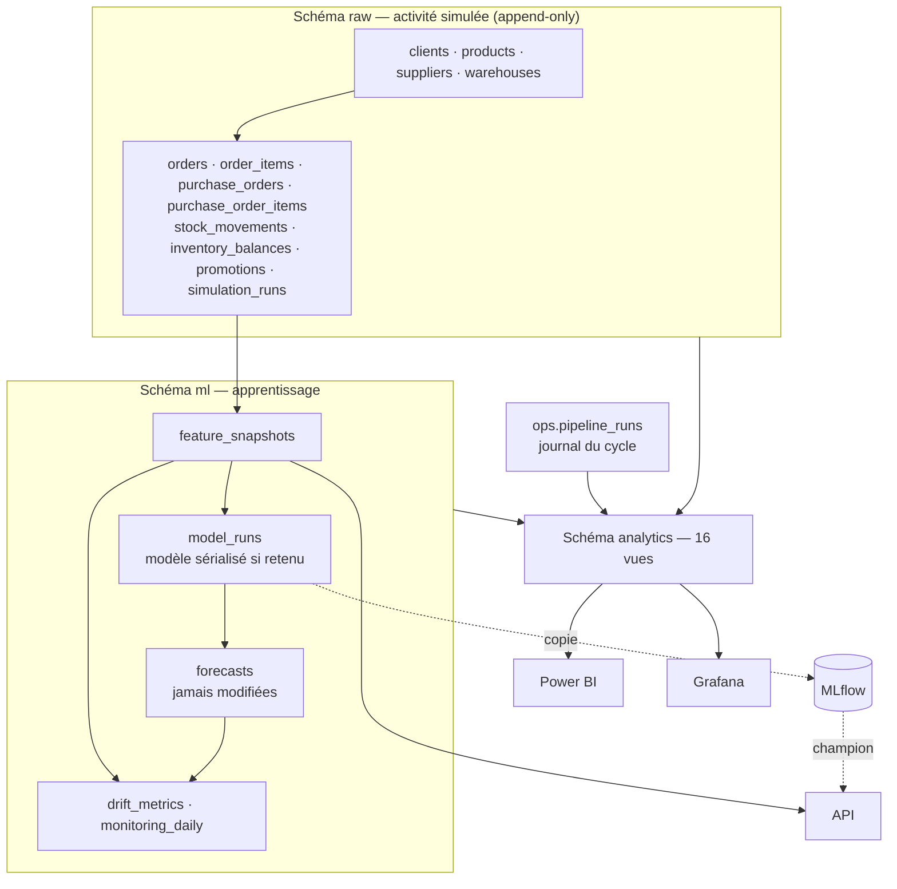

# Architecture — SmartSupply AI

État réel au 21/11/2026. Vue d'ensemble et démarrage : [README](../README.md).

## 1. Composants

| Conteneur | Image | Rôle | Dépend de |
|---|---|---|---|
| `postgres` | postgres:16 | Base unique : schémas `raw`, `ml`, `ops`, `analytics` (+ base séparée `mlflow`) | — |
| `prefect` | prefecthq/prefect:3 | Serveur d'orchestration, interface, historique des runs | — |
| `pipeline` | smartsupply-app (Dockerfile) | Sert le flow `cycle-nocturne` (planification + rattrapage au démarrage) | postgres, prefect |
| `api` | smartsupply-app (même image) | FastAPI : prévisions et simulation avec le champion MLflow | postgres (MLflow facultatif) |
| `mlflow` | smartsupply-mlflow (docker/mlflow) | Suivi des entraînements + registre ; crée sa base `mlflow` au 1er démarrage | postgres |
| `pushgateway` | prom/pushgateway | Reçoit les chiffres déposés par le cycle à la fin de chaque passage | — |
| `postgres-exporter` | prometheuscommunity/postgres-exporter | État de PostgreSQL pour Prometheus | postgres |
| `prometheus` | prom/prometheus (LTS 3.13) | Relève toutes les 30 s : cycle, API, MLflow, Prefect, PostgreSQL, Alertmanager ; évalue les alertes | — |
| `alertmanager` | prom/alertmanager | Regroupe les alertes et les envoie par e-mail (SMTP de `.env`) | — |
| `grafana` | grafana/grafana:13 | 3 tableaux de bord provisionnés ; lit Prometheus et les vues `analytics` | prometheus, postgres |

Hors Docker : **Power BI Desktop** (lit les vues `analytics` avec `powerbi_reader`) et une **tâche planifiée Windows** (`scripts/install_alert.ps1` → `python -m smartsupply.health --notify`).

## 2. Flux de données

## 3. Le cycle (`src/smartsupply/pipelines/simulation_flow.py`)

| Étape (tâche Prefect) | Module | Écrit dans |
|---|---|---|
| `simulate_days` | `generator.runner` | `raw.*` (une transaction par journée) |
| `check_quality` | `quality.checks` | — (lève une erreur, le flow s'arrête) |
| `build_features` | `features.build` | `ml.feature_snapshots` |
| `retrain_model` | `models.nightly.retrain` | `ml.model_runs` |
| `forecast_next_week` | `models.nightly.forecast_latest` | `ml.forecasts` |
| `monitor_model` | `models.monitoring` | `ml.drift_metrics`, `ml.monitoring_daily` |
| `sync_tracking` | `models.tracking` | MLflow (runs, registre, alias `champion`) |
| `publish_metrics` | `metrics` | Pushgateway |
| `record_run` / `on_flow_failure` | `pipelines.simulation_flow` | `ops.pipeline_runs` |

**Planification :** `30 2 * * *` et `15 8-23/3 * * *` (Europe/Paris), `limit=1` (jamais deux passages en même temps). Chaque étape est **idempotente** : refaire un passage ne crée aucun doublon.

**Règle de mise en service** (`models.nightly.decide`) : le challenger est entraîné sans les 8 dernières semaines étiquetées (trou de 7 jours), évalué sur ces 8 semaines, et retenu seulement s'il (1) bat la méthode naïve 28 j, (2) a un |biais| ≤ 5 %, (3) n'est pas plus mauvais que le champion de plus d'1 point de WAPE. S'il est retenu, il est réentraîné sur toutes les données étiquetées.

## 4. Schémas de la base

### `raw` — activité simulée
| Table | Contenu |
|---|---|
| `clients`, `products`, `suppliers`, `warehouses` | Référentiel Faker (seed 42) ; nouveaux clients ajoutés au fil de l'eau |
| `orders`, `order_items` | Commandes ; `requested_qty` = demandé, `fulfilled_qty` = servi, `lost_sales_qty` = perdu |
| `purchase_orders`, `purchase_order_items` | Achats fournisseurs, délais et retards simulés |
| `stock_movements` | Journal append-only des entrées / sorties (trigger interdisant UPDATE/DELETE) |
| `inventory_balances` | Solde de stock, toujours égal à la somme du journal (contrôle qualité) |
| `promotions` | Promotions annoncées à l'avance |
| `simulation_runs` | Une ligne par journée simulée (reprise sans doublon) |

### `ml` — apprentissage et surveillance
| Table | Contenu |
|---|---|
| `feature_snapshots` | Une ligne par produit et par jour ; cible `target_demand_next_7d` vide tant que les 7 jours ne sont pas passés |
| `training_datasets` | Versions exportées du dataset (Parquet) |
| `model_runs` | Un entraînement par nuit : scores, décision, raison, réglages ; `model_blob` = modèle si retenu |
| `forecasts` | Prévisions à 7 jours ; clé (jour, produit), jamais modifiées |
| `drift_metrics` | PSI de chaque variable, chaque jour |
| `monitoring_daily` | Résumé du jour : dérive + erreur réelle ; colonnes `*_logged` = déjà dans MLflow |

### `ops`
| Table | Contenu |
|---|---|
| `pipeline_runs` | Un passage du cycle : début, fin, `ok` / `échec`, journées ajoutées, message |

### `analytics` — 16 vues (seul schéma visible par Power BI et Grafana)
| Vue | Utilisée par |
|---|---|
| `v_daily_sales`, `v_daily_kpis`, `v_product_performance` | Power BI — Vue direction |
| `v_stock_status`, `v_supplier_reliability`, `v_incoming_receipts`, `v_promotions` | Power BI (stocks, fournisseurs, promotions) |
| `v_forecasts`, `v_forecast_accuracy`, `v_model_runs` | Power BI — Prévisions ; Grafana — Modèle ; API |
| `v_clients`, `v_clients_monthly` | Power BI — Clients |
| `v_pipeline_health` | Power BI (carte « État du cycle »), Grafana, alerte Windows, `verify` |
| `v_monitoring_daily`, `v_drift_metrics`, `v_pipeline_runs` | Grafana |

## 5. Comptes et sécurité

| Compte PostgreSQL | Utilisé par | Droits |
|---|---|---|
| `smartsupply` (`.env`) | pipeline, API, MLflow, exportateur, commandes locales | Propriétaire |
| `powerbi_reader` | Power BI | Lecture seule, schéma `analytics` uniquement |
| `grafana_reader` | Grafana | Lecture seule, schéma `analytics` uniquement, requêtes limitées à 30 s |

Secrets uniquement dans `.env` (jamais versionné) : mots de passe PostgreSQL / Grafana, compte SMTP et mot de passe d'application. Les configurations (Alertmanager, Grafana, MLflow) reçoivent ces valeurs par variables d'environnement au démarrage. Tous les ports sont liés à `127.0.0.1`.

## 6. Observabilité

| Source | Chiffres | Relevés par |
|---|---|---|
| Cycle (Pushgateway) | `smartsupply_pipeline_*`, `smartsupply_model_*`, `smartsupply_drift_*`, `smartsupply_real_*`, `smartsupply_forecast_*` | Prometheus, job `pipeline` |
| API | `smartsupply_api_requests_total`, `..._request_duration_seconds`, `..._predictions_total`, `..._model_info` | job `api` |
| MLflow | `mlflow_http_request_*` | job `mlflow` |
| Prefect | métriques de l'API Prefect (`/api/metrics`) | job `prefect` |
| PostgreSQL | `pg_up`, `pg_database_size_bytes`, `pg_stat_database_*` | job `postgres` |

Règles d'alerte : `docker/prometheus/alerts.yml`. Envoi : `docker/alertmanager/alertmanager.yml`. Tableaux Grafana : générés par `scripts/build_grafana_dashboards.py` dans `docker/grafana/dashboards/`.
