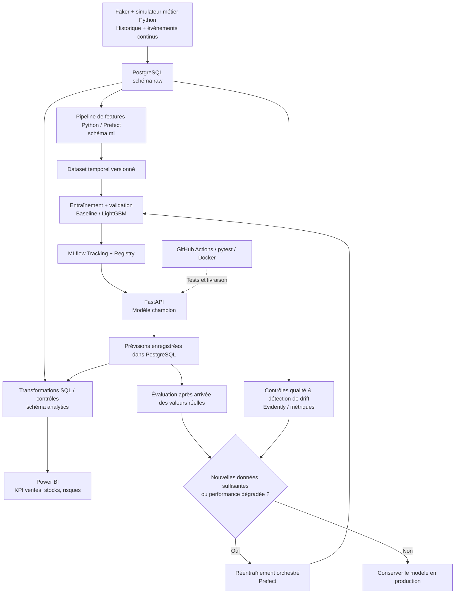

> **Document de cadrage initial (20/11/2026), conservé tel quel pour l'historique.**
> Il décrit le projet tel qu'il était **prévu** au départ. Ce qui est réellement en place est décrit dans le [README](../README.md) ; l'architecture détaillée dans [architecture.md](architecture.md).

# SmartSupply AI

**Plateforme de prévision de la demande et de gestion des risques de rupture de stock — Data Engineering, Power BI, Machine Learning et MLOps**

> **Statut : cahier des charges / feuille de route.** Ce README décrit l'architecture cible et les tâches à réaliser. Les composants, tests et résultats décrits ci-dessous **ne sont pas encore implémentés**.
>
> **Données : 100 % synthétiques.** Faker fabrique des identités et attributs fictifs ; un moteur de simulation métier crée les événements temporels et leurs relations. Les prédictions obtenues sur cette simulation ne constituent pas une validation sur des entreprises réelles.

## 1. Objectif du projet

Créer, de zéro jusqu'au déploiement, un système reproduisant la chaîne de données et le cycle de vie d'un modèle de ML dans une entreprise de distribution :

1. Générer un historique commercial et des événements continus avec **Faker + Python**.
2. Stocker les données de façon fiable dans **PostgreSQL**.
3. Construire des **tableaux de bord Power BI** depuis les vues PostgreSQL.
4. Construire automatiquement un **dataset ML à partir de PostgreSQL**.
5. Entraîner des modèles capables de **prévoir la demande des 7 prochains jours** par produit (et, à terme, par entrepôt).
6. Déduire le **risque de rupture de stock** des prévisions et des niveaux de stock ; éventuellement entraîner un classifieur dédié dans une seconde version.
7. Déployer une API de prédiction, tracer toutes les expériences, surveiller les données et les performances, et **réentraîner automatiquement sous conditions**.
8. Écrire les prévisions en base pour que Power BI compare **prévu vs réalisé**.

### Questions métier à résoudre

- Quels produits risquent de manquer dans les 7 prochains jours ?
- Quelle quantité prévoir / réapprovisionner, selon les délais fournisseurs et un stock de sécurité ?
- Quelles familles de produits évoluent le plus ?
- Les performances du modèle se dégradent-elles lorsque la demande change ?
- Le nouveau modèle apporte-t-il une amélioration par rapport au modèle actuellement utilisé ?

### Livrable final attendu

Une démonstration reproductible comprenant une base alimentée en continu, un dashboard Power BI, un pipeline de création de datasets, un modèle exposé par API, un registre de modèles, un workflow automatique de réentraînement, du monitoring, des tests et une documentation exploitable sur GitHub.

---

## 2. Architecture cible



**Point essentiel : Power BI n'est PAS la source du dataset ML.** Les flux Power BI et ML lisent tous deux PostgreSQL ; le ML réécrit ses prédictions en base, puis Power BI les affiche. Pas d'export CSV manuel obligatoire.

**Deux horloges sont conservées :** `event_time` (date métier simulée) et `ingested_at` (instant réel de réception). Les labels, les features, les agrégations et les contrôles de fraîcheur reposent sur l'horloge adaptée.

---

## 3. Stack technique

| Domaine | Outils retenus | Rôle |
|---|---|---|
| Langage | Python | Simulateur, pipelines et ML |
| Génération | Faker, NumPy | Identités fictives + distributions statistiques |
| Base | PostgreSQL | Historique, features, prédictions et logs |
| Accès SQL | SQLAlchemy, psycopg | Écriture, lecture et transactions |
| Transformation | SQL, pandas, Pandera (ou équivalent) | Qualité et préparation |
| Orchestration | Prefect | Exécution planifiée, dépendances, retries |
| BI | Power BI Desktop | Dashboards depuis les vues PostgreSQL |
| ML | scikit-learn, LightGBM | Baselines et modèles de prévision |
| Expériences | MLflow | Métriques, paramètres, modèles versionnés |
| API | FastAPI + Pydantic | Inférence contrôlée et documentation |
| Conteneurs | Docker / Docker Compose | Exécution locale reproductible |
| CI/CD | GitHub Actions | Vérification automatique du code et déploiement ciblé |
| Monitoring | Prometheus/Grafana, Evidently | Santé des services, drift, métriques de prédiction |
| Tests | pytest | Tests unitaires, intégration et non-régression |

**Approche progressive :** commencer avec PostgreSQL + Python + Power BI ; ne pas installer toute la pile d'un seul coup. Choisir des versions compatibles et les verrouiller dans les fichiers de dépendances.

---

## 4. Périmètre des données : ERP fictif

Entreprise simulée : distributeur B2B/B2C de produits courants, disposant de plusieurs entrepôts, de clients, de fournisseurs et d'un catalogue.

### 4.1 Tables du schéma `raw`

| Table | Colonnes minimales | Notes |
|---|---|---|
| `raw.clients` | `client_id`, `name`, `segment`, `city`, `created_at` | Noms synthétiques Faker |
| `raw.suppliers` | `supplier_id`, `name`, `country`, `lead_time_days`, `reliability_score` | Délais et fiabilité simulés |
| `raw.products` | `product_id`, `sku`, `name`, `category`, `unit_cost`, `unit_price`, `supplier_id`, `created_at`, `active` | Prix cohérents, fournisseurs existants |
| `raw.warehouses` | `warehouse_id`, `name`, `city`, `capacity` | Emplacements de stock |
| `raw.orders` | `order_id`, `client_id`, `ordered_at`, `status`, `channel` | Événements commerciaux |
| `raw.order_items` | `order_item_id`, `order_id`, `product_id`, `warehouse_id`, `requested_qty`, `fulfilled_qty`, `lost_sales_qty`, `unit_price` | Demande ≠ ventes en cas de rupture |
| `raw.purchase_orders` | `po_id`, `supplier_id`, `warehouse_id`, `ordered_at`, `expected_at`, `received_at`, `status` | Retards possibles |
| `raw.purchase_order_items` | `po_item_id`, `po_id`, `product_id`, `ordered_qty`, `received_qty`, `unit_cost` | Approvisionnements |
| `raw.stock_movements` | `movement_id`, `event_time`, `product_id`, `warehouse_id`, `movement_type`, `quantity_delta`, `source_id` | Journal append-only des entrées/sorties |
| `raw.inventory_balances` | `product_id`, `warehouse_id`, `on_hand_qty`, `updated_at` | Solde matérialisé, cohérent avec le journal |
| `raw.promotions` | `promotion_id`, `product_id`, `starts_at`, `ends_at`, `discount_pct` | Événements influant sur la demande |
| `raw.simulation_runs` | `run_id`, `seed`, `simulated_date`, `started_at`, `status` | Traçabilité et reprise du générateur |

### 4.2 Schémas dérivés

**`analytics`**, principalement des vues ou tables agrégées :
- `analytics.v_daily_sales`
- `analytics.v_product_performance`
- `analytics.v_stock_status`
- `analytics.v_supplier_reliability`
- `analytics.v_forecast_vs_actual`

**`ml`**, données techniques :
- `ml.feature_snapshots` : variables connues à une date de coupure (`as_of_date`).
- `ml.training_datasets` : identifiants / métadonnées des jeux d'entraînement, pas nécessairement chaque ligne du dataset.
- `ml.forecasts` : `product_id`, `warehouse_id`, `as_of_date`, `horizon_days`, `predicted_demand`, `model_version`, `generated_at`.
- `ml.model_evaluations` : métriques sur périodes connues.
- `ml.monitoring_events` : drift, erreurs, anomalies, événements de réentraînement.

### 4.3 Contraintes métier obligatoires

- Toutes les clés étrangères doivent désigner des enregistrements existants.
- Aucune quantité négative dans les commandes ou réceptions ; les sorties du journal de stock ont un `quantity_delta` négatif.
- `fulfilled_qty <= requested_qty` et `lost_sales_qty = requested_qty - fulfilled_qty` si la demande non servie est définitivement perdue (définir séparément le cas des commandes en attente).
- `on_hand_qty >= 0` ; une vente ne peut sortir plus que le stock disponible.
- Réception uniquement après commande d'approvisionnement ; délai réel plausible autour du délai fournisseur.
- Les ventes, la demande, le stock et les promotions sont liés dans le temps.
- Pas de commandes datées avant l'existence du produit ou du client concerné.
- Toutes les opérations financières utilisent une devise définie et des décimales adaptées.
- Journaux événementiels append-only et écritures idempotentes afin de supporter les relances.

---

## 5. Simulateur Faker : historique + flux continu

### 5.1 Pourquoi Faker ne suffit pas

Faker sait créer des noms, identifiants, adresses, dates et textes fictifs. Un **moteur métier supplémentaire** doit calculer la demande, vérifier les stocks, appliquer les promotions, planifier les achats, recevoir les livraisons et mettre à jour les soldes. Sans cela, le ML apprendra surtout du hasard.

### 5.2 Paramètres de départ (modifiables)

| Paramètre | Proposition |
|---|---|
| Historique initial | 24 mois simulés |
| Clients | 5 000 |
| Produits | 1 000 |
| Fournisseurs | 100 |
| Entrepôts | 3 |
| Commandes historiques | Environ 200 000 (ordre de grandeur) |
| Cadence de démonstration | 1 minute réelle = 1 jour simulé |
| Seed de reproductibilité | 42 |
| Stockage | Insertion par lots, transactions PostgreSQL |

### 5.3 Étapes de simulation pour chaque jour `D`

1. Initialiser la date simulée et charger l'état courant (catalogue, stocks, commandes d'achat en transit).
2. Recevoir les approvisionnements effectivement arrivés ; enregistrer les mouvements positifs.
3. Calculer la **demande latente** par produit : tendance + jour de semaine + saisonnalité + promotion + variation de prix + effet de clientèle + bruit statistique.
4. Générer les commandes correspondant à cette demande avec des clients Faker cohérents.
5. Allouer le stock disponible, puis distinguer demande demandée / satisfaite / perdue ; enregistrer les mouvements négatifs.
6. Déclencher des approvisionnements selon une règle de gestion définie, puis programmer la date de livraison avec variabilité fournisseur.
7. Vérifier les contraintes et écrire atomiquement les nouveaux événements.
8. Sauvegarder le curseur de simulation pour reprendre **sans doublons** après un redémarrage.

### 5.4 Phénomènes à intégrer progressivement

- Saisonnalité, fêtes, promotions et effets du prix.
- Différences entre produits rapides et lents ; produits lancés / arrêtés.
- Clients réguliers et occasionnels.
- Délais fournisseurs variables, livraisons partielles et retards.
- Ruptures de stock, demande non satisfaite et surstock.
- **Drift contrôlé** : à une date simulée précise, changer une règle (nouvelle saisonnalité, augmentation soudaine de la demande, retard systématique d'un fournisseur). Le changement doit être documenté comme scénario de test.

### 5.5 Modes d'exécution

- `bootstrap` : reconstruire un historique reproductible de 24 mois.
- `stream` : ajouter continuellement des jours simulés sans effacer l'historique.
- `once` : produire un seul jour pour les tests et débogages.
- `scenario` : activer explicitement une perturbation afin de tester le monitoring et le réentraînement.

**Règle :** le générateur ne doit pas modifier rétroactivement les lignes historiques après que le modèle les a vues. Conserver un journal de simulation et les seeds par exécution.

---

## 6. Power BI : tableaux de bord métier

Power BI lit exclusivement les vues / tables du schéma `analytics`, avec un utilisateur PostgreSQL en lecture seule.

### Pages prévues

1. **Vue direction** : chiffre d'affaires, volume vendu, évolution mensuelle, marge brute *simulée*.
2. **Ventes et produits** : top produits, catégories, volumes, effet promotions, produits peu actifs.
3. **Stocks et ruptures** : stock disponible par produit / entrepôt, incidents de rupture, demande perdue.
4. **Fournisseurs** : délai prévu/réel, taux de retard, fiabilité, réceptions à venir.
5. **Prévisions ML** : prévu vs réalisé, produits à risque, WAPE / MAE par période, version du modèle.

### Mode de rafraîchissement

- Pour commencer : Power BI Desktop + **Import** et actualisation manuelle lors des premières vérifications.
- Pour observer le flux plus directement : évaluer **DirectQuery** et ses contraintes de performances ; PostgreSQL est un connecteur pris en charge.
- Si le rapport est publié dans Power BI Service et que PostgreSQL reste local/privé : prévoir la **passerelle de données** et vérifier les droits/licences de rafraîchissement applicables.
- Tester la charge SQL et éviter d'interroger les tables brutes à chaque visuel.

**Critère de validation :** après génération d'une journée supplémentaire, les chiffres Power BI reflètent les nouveaux événements après rafraîchissement (ou requête DirectQuery appropriée).

---

## 7. Dataset Machine Learning

### 7.1 Problème principal, volontairement limité pour le MVP

**Régression de demande** : prédire, pour chaque produit (puis produit × entrepôt), le **nombre total d'unités demandées sur les 7 prochains jours simulés**.

Il faut préférer la **demande demandée** (`requested_qty`) aux ventes servies (`fulfilled_qty`) si l'objectif est d'éviter les ruptures : des ventes nulles pendant une rupture ne signifient pas une demande nulle.

### 7.2 Grain et colonnes

Une ligne du dataset = **un produit à une date d'observation** (`as_of_date`) ; conserver la dimension entrepôt lorsqu'elle devient pertinente.

Variables disponibles à cette date uniquement :

- `product_id`, `category`, `supplier_id`, `as_of_date`
- `demand_lag_1`, `demand_lag_7`, `demand_lag_14`, `demand_lag_28`
- `demand_rolling_mean_7`, `demand_rolling_mean_28`, `demand_rolling_std_28`
- `price_as_of`, `promotion_active`, `discount_pct`
- `weekday`, `month`, `is_weekend`, autres caractéristiques calendaires connues
- `stock_as_of`, `incoming_qty_known_as_of`, `supplier_lead_time_known_as_of`

**Cible :** `target_demand_next_7d` = somme des unités demandées pendant `D+1 ... D+7`. La cible n'est renseignée qu'une fois la fenêtre terminée.

### 7.3 Anti-fuite de données (obligatoire)

- Une variable calculée à `D` ne peut exploiter aucun événement survenu après `D`.
- Les lags/rolling statistics doivent exclure les valeurs futures, y compris à travers les jointures et les promotions.
- Ne jamais utiliser un `stock_after_sales` futur ou une livraison non connue à la date de décision.
- Découpage **chronologique** train/validation/test, pas de séparation aléatoire de lignes dépendantes du temps.
- Pour une cible à horizon 7 jours, prévoir un intervalle de séparation suffisant pour éviter le chevauchement de fenêtres de cible entre ensembles.
- Conserver la version du dataset, la période couverte, la seed et le code de transformation.

### 7.4 Exemple de répartition initiale

- Entraînement : mois 1–16 (dates d'observation éligibles).
- Validation : mois 18–20.
- Test final : mois 22–24.
- Mois intermédiaires comme **zones de séparation** pour éviter la contamination temporelle.

Les bornes exactes sont recalculées selon l'horizon de 7 jours et la disponibilité des labels. Mettre en place une **validation glissante (rolling-origin)** sur la période d'entraînement/validation.

---

## 8. Modélisation Machine Learning

### Étape 1 — Baselines

- Demande moyenne des 7 derniers jours × 7.
- Demande de la même semaine précédente (baseline saisonnière simple).
- Option : une moyenne pondérée des semaines récentes.

### Étape 2 — Modèles candidats

- Modèle de régression simple ou Random Forest comme référence supplémentaire.
- **LightGBM** en modèle principal candidat.
- Ajouter des architectures plus complexes **seulement** après une évaluation correcte des baselines.

### Étape 3 — Mesures

- **MAE** : erreur moyenne absolue en unités.
- **WAPE** : erreur absolue totale / demande totale, en précisant sa sensibilité aux faibles volumes.
- **Biais** : tendance à systématiquement sur- ou sous-prédire.
- Segments : catégorie, produits à faible demande, entrepôt, promotion, période de drift.

### Étape 4 — Décision métier

À partir de la demande prévue, du stock et des livraisons attendues **connues à D**, calculer un score de risque de rupture et une suggestion d'approvisionnement selon une règle explicitement documentée (délai fournisseur + stock de sécurité). Ne pas présenter un simple seuil comme une probabilité statistiquement calibrée.

### Critère de validation

Le candidat doit dépasser **au moins une baseline solide sur le jeu de validation**, sans dégradation excessive sur les segments critiques. Le jeu de test final est réservé à l'évaluation honnête, pas au réglage continu.

---

## 9. MLOps : automatisation de bout en bout

### 9.1 Pipelines Prefect

| Flow | Déclencheur proposé | Sortie |
|---|---|---|
| `bootstrap_history` | Manuel, une fois | Historique synthétique initial |
| `simulate_new_day` | Chaque minute réelle en mode démo | Événements d'une journée simulée |
| `data_quality` | Après ingestion | Rapport qualité + statut |
| `build_features` | Après validation des données | Snapshot features daté |
| `predict_demand` | À chaque nouvelle date simulée | Prévisions à 7 jours dans `ml.forecasts` |
| `evaluate_predictions` | Quand les 7 jours futurs deviennent connus | Métriques du modèle en place |
| `detect_drift` | Périodique (ex. 5 jours simulés) | Rapport de drift |
| `retrain_candidate` | Conditionnel ; au maximum tous les 30 jours simulés en démo | Nouveau modèle candidat MLflow |
| `evaluate_and_promote` | Après entraînement candidat | Conserver ou remplacer le champion |

### 9.2 MLflow

Pour chaque essai enregistrer :
- Version du code, de la seed et du dataset.
- Paramètres, durée, métriques globales et par segment.
- Artefacts d'évaluation et modèle entraîné.
- Une version dans le **Model Registry**.
- Alias `champion` pour le modèle actuellement servi ; `candidate` pour un modèle en évaluation.

### 9.3 Politique de réentraînement automatique

**Ne pas réentraîner à chaque ligne insérée.** Exemple de règles initiales configurables :

- Au moins 30 nouveaux jours simulés, **ou** performance significativement dégradée avec suffisamment de labels.
- Un minimum configurable de nouvelles observations valides.
- Aucun contrôle critique de qualité des données en échec.
- Un délai minimal entre deux entraînements pour limiter le coût.

**Promotion automatique uniquement si :**

1. Le pipeline a terminé sans erreur et l'artefact du modèle est chargeable.
2. Le candidat est évalué sur une fenêtre temporelle récente **non utilisée pour l'ajustement du candidat** et selon une politique stable.
3. Les métriques sont meilleures que celles du champion au-delà d'une marge définie, ou satisfont des règles métier documentées.
4. Il n'y a pas de forte régression dans les catégories critiques.
5. Les tests de non-régression API et de schéma passent.

Sinon, le `champion` reste en place. Prévoir **journal d'audit et rollback** de l'alias MLflow.

### 9.4 Déploiement et inférence

API FastAPI envisagée :

- `GET /health` : santé de l'API.
- `GET /model` : identifiant/version du champion.
- `POST /predict/demand` : prévision à 7 jours pour un produit/date/entrepôt, avec variables ou contexte récupéré dans PostgreSQL.
- `GET /forecasts` : consultation paginée des prévisions sauvegardées.
- `POST /admin/retrain` : optionnel, **protégé** (authentification) pour lancer un entraînement contrôlé.

Préférer un service d'inférence capable de charger et de vérifier la nouvelle version **avant** de la rendre active, puis basculer avec possibilité de retour arrière. La rotation d'alias MLflow ne suffit pas, à elle seule, à rafraîchir un processus API déjà chargé en mémoire.

---

## 10. Monitoring et observabilité

Distinguer trois niveaux :

1. **Infra/plateforme** : statut Docker, CPU/RAM, disponibilité PostgreSQL, erreurs API, latence, échecs Prefect.
2. **Données** : valeurs nulles, clés orphelines, anomalies temporelles, doublons, fraîcheur et drift de distribution.
3. **Modèle et métier** : MAE/WAPE/biais lorsque les labels à 7 jours sont disponibles, volumes de rupture, variation des prévisions, efficacité simulée des suggestions de réapprovisionnement.

**Important :** en prévision à 7 jours, une prévision de ce matin ne peut pas être jugée avec un résultat réel qui n'existe pas encore. Les erreurs ne sont calculées qu'après expiration de l'horizon. Les premières alertes peuvent venir de la qualité et du drift, mais un drift ne garantit pas une baisse de performance.

### Scénario de démonstration du MLOps

1. Le modèle v1 est en service et prédit correctement le régime initial.
2. Activer un scénario de hausse durable de demande après une date simulée connue.
3. Les données nouvelles arrivent ; le monitoring observe une évolution de distribution.
4. Après sept jours simulés, le pipeline reçoit les valeurs réelles correspondant aux anciennes prévisions et mesure leur qualité.
5. Le flow de réentraînement se déclenche uniquement si les conditions sont réunies.
6. MLflow compare v1 et v2 ; une promotion ne se fait que si v2 satisfait les critères.
7. Power BI affiche l'historique des prévisions, erreurs et versions de modèle.

---

## 11. Structure proposée du dépôt GitHub

```text
smartsupply-ai/
├── README.md
├── LICENSE
├── .env.example
├── .gitignore
├── pyproject.toml
├── docker-compose.yml
├── Makefile
├── configs/
│   ├── simulation.yaml
│   ├── training.yaml
│   └── monitoring.yaml
├── database/
│   ├── migrations/
│   ├── schema.sql
│   ├── analytics_views.sql
│   └── seeds/
├── src/
│   └── smartsupply/
│       ├── generator/           # Faker, règles métier, flux continu
│       ├── db/                  # Connexion SQL, transactions, requêtes
│       ├── quality/             # Validation des données
│       ├── pipelines/           # Flows Prefect
│       ├── features/            # Dataset temporel
│       ├── models/              # Baselines, entraînement, évaluation
│       ├── registry/            # Enregistrement/promotion MLflow
│       ├── inference/           # Service FastAPI
│       └── monitoring/          # Drift, labels différés, alertes
├── tests/
│   ├── unit/
│   ├── integration/
│   └── e2e/
├── notebooks/                  # EDA, prototypes non productifs
├── dashboards/
│   └── powerbi/                # .pbix (si licence et taille compatibles)
├── docs/
│   ├── architecture.md
│   ├── data_dictionary.md
│   ├── model_card.md
│   ├── runbook.md
│   └── screenshots/
├── scripts/
│   ├── bootstrap.py
│   ├── simulate_once.py
│   └── smoke_test.py
└── .github/
    └── workflows/
        ├── ci.yml
        └── deploy.yml
```

Ne pas créer tous les services ou tous les fichiers à vide immédiatement : cette structure est la **cible finale**.

---

## 12. Feuille de route : du premier commit à la soutenance

Chaque phase se termine par un livrable et une **définition de terminé (DoD)**.

### Phase 0 — Cadrage du projet

- [ ] Créer le dépôt GitHub et mettre ce README à la racine.
- [ ] Définir la problématique, le scénario d'entreprise et les KPI.
- [ ] Décider du grain de prévision MVP : produit × date ; horizon = 7 jours.
- [ ] Définir les unités, devise, fuseau horaire, horloge simulée et volumes.
- [ ] Documenter les choix et limites des données fictives.

**Livrable :** README, diagramme d'architecture, backlog GitHub Issues.

**DoD :** chaque composant a un rôle explicite et la cible ML est définie sans ambiguïté.

### Phase 1 — Base PostgreSQL et premières données Faker

- [ ] Installer Python, Docker, Git et PostgreSQL dans Docker Compose.
- [ ] Mettre secrets/identifiants dans `.env` (jamais dans Git).
- [ ] Créer les schémas `raw`, `analytics`, `ml`.
- [ ] Créer les tables, clés étrangères, contraintes et index de base.
- [ ] Générer 100 clients, 50 produits, 10 fournisseurs, 3 entrepôts.
- [ ] Écrire les tests d'intégrité et les requêtes SQL de vérification.
- [ ] Initialiser un générateur reproductible (`seed=42`).

**Livrable :** PostgreSQL opérationnel et premières données consultables.

**DoD :** insertion depuis Python, schéma versionné, zéro clé étrangère invalide, tests verts.

### Phase 2 — Simulateur d'activité commerciale

- [ ] Ajouter commandes, lignes, approvisionnements, mouvements de stock.
- [ ] Écrire les règles de demande, ruptures, prix, saisonnalité, promotions, délais.
- [ ] Implémenter le mode `once` pour simuler une journée.
- [ ] Implémenter le mode `bootstrap` pour 24 mois historiques.
- [ ] Implémenter le mode `stream` (une journée simulée/minute réelle).
- [ ] Gérer les redémarrages, transactions et réexécutions idempotentes.
- [ ] Créer des tests sur les stocks et le passage d'une journée à la suivante.

**Livrable :** la base s'enrichit en continu de données cohérentes.

**DoD :** aucun stock négatif, aucun doublon après relance, scénarios métier reproductibles.

### Phase 3 — Data Engineering / qualité

- [ ] Construire les vues `analytics`.
- [ ] Ajouter des contrôles de qualité (ex. Pandera + SQL).
- [ ] Orchestrer ingestion → contrôles → transformations avec Prefect.
- [ ] Ajouter journalisation, retries raisonnables, alertes d'échec.
- [ ] Écrire les tests des transformations et de la reprise.

**Livrable :** pipeline de données orchestré et observable.

**DoD :** nouveaux événements intégrés sans intervention manuelle et erreurs traçables.

### Phase 4 — Power BI

- [ ] Connecter Power BI Desktop à PostgreSQL.
- [ ] Créer 5 pages de dashboard métier.
- [ ] Vérifier le total des ventes par comparaison avec SQL.
- [ ] Tester l'actualisation et documenter Import/DirectQuery.
- [ ] Préparer des captures d'écran réelles du dashboard.

**Livrable :** dashboard Power BI opérationnel, sur données qui évoluent.

**DoD :** chiffres expliqués et cohérents avec PostgreSQL ; nouvelles données visibles après rafraîchissement.

### Phase 5 — Dataset ML / EDA

- [ ] Définir la requête de demande quotidienne par produit.
- [ ] Construire les lags, moyennes mobiles et variables calendaires.
- [ ] Calculer la cible `target_demand_next_7d` seulement quand connue.
- [ ] Versionner les extractions et tests de cohérence des features.
- [ ] Réaliser une EDA et une séparation temporelle.
- [ ] Tester explicitement l'absence de fuite des informations futures.

**Livrable :** dataset ML reproductible, documenté et prêt pour l'entraînement.

**DoD :** un autre développeur peut reconstruire le même dataset sur le même snapshot.

### Phase 6 — Modélisation / évaluation

- [ ] Établir deux baselines simples.
- [ ] Entraîner un premier modèle (régression), puis LightGBM.
- [ ] Effectuer une validation chronologique glissante.
- [ ] Mesurer MAE, WAPE, biais et performances par segment.
- [ ] Analyser les erreurs sur promotions, ruptures et changements de régime.
- [ ] Produire une `model_card.md` avec limites des données synthétiques.

**Livrable :** premier modèle validé, métriques reproductibles et limites explicites.

**DoD :** le choix du modèle est justifié face aux baselines, avec test temporel réservé.

### Phase 7 — API et MLflow

- [ ] Installer MLflow Tracking et Model Registry.
- [ ] Enregistrer expériences, paramètres, métriques et artefacts.
- [ ] Définir `champion` et `candidate`.
- [ ] Créer FastAPI avec `GET /health`, `GET /model`, `POST /predict/demand`.
- [ ] Stocker les prévisions dans `ml.forecasts`.
- [ ] Dockeriser et tester l'inférence de bout en bout.

**Livrable :** modèle accessible via API et prévisions consultables dans PostgreSQL.

**DoD :** une requête valide retourne une prévision versionnée ; l'API gère les erreurs.

### Phase 8 — Automatisation MLOps

- [ ] Créer flows Prefect de features, prédictions, évaluation et entraînement.
- [ ] Définir des déclencheurs de réentraînement contrôlés.
- [ ] Comparer candidat/champion sur un jeu récent indépendant.
- [ ] Automatiser la promotion uniquement en cas de validation.
- [ ] Tester le maintien du champion en cas d'échec.
- [ ] Tester le rollback vers une version antérieure.

**Livrable :** boucle contrôlée de réentraînement et de promotion.

**DoD :** nouvelle donnée → prédiction → évaluation différée → éventuel réentraînement ; aucune mauvaise version ne remplace automatiquement le champion.

### Phase 9 — Monitoring, dérive et observabilité

- [ ] Ajouter métriques d'infrastructure (Prometheus/Grafana si utile).
- [ ] Ajouter qualité et drift des données (Evidently si utile).
- [ ] Mesurer MAE/WAPE après disponibilité des vrais labels simulés.
- [ ] Déclencher un changement de comportement artificiel documenté.
- [ ] Démontrer une alerte, une comparaison de modèles, puis une promotion ou un refus.
- [ ] Ajouter dans Power BI prévu vs réalisé et historique des versions.

**Livrable :** démo de dérive, monitoring et récupération.

**DoD :** le système prouve pourquoi il conserve ou remplace un modèle.

### Phase 10 — CI/CD, sécurité, livraison finale

- [ ] Créer pipeline GitHub Actions : lint, tests, build Docker, contrôles de sécurité adaptés.
- [ ] Tester avec une base PostgreSQL temporaire en intégration.
- [ ] Verrouiller les dépendances, documenter les migrations et sauvegardes.
- [ ] Séparer dev/test/prod ; protéger les secrets, l'API d'administration et PostgreSQL.
- [ ] Préparer un déploiement local reproductible ; distant si souhaité et sécurisé.
- [ ] Écrire le runbook : démarrage, arrêt, incidents, rollback, restauration.
- [ ] Publier schéma d'architecture, GIF/vidéo de démo et captures réelles.
- [ ] Documenter performances, limites et pistes d'amélioration.

**Livrable :** dépôt GitHub portfolio prêt à présenter en entretien.

**DoD :** documentation vérifiée ; un tiers peut démarrer le système et reproduire la démonstration sans utiliser tes secrets.

---

## 13. Plan de travail réaliste : MVP puis version avancée

### MVP obligatoire (ne rien ajouter avant d'avoir terminé)

1. PostgreSQL + Faker : historique de 24 mois et nouvelles journées générées.
2. Dataset pour la prévision de demande à 7 jours.
3. Baseline + LightGBM + évaluation temporelle.
4. Power BI : ventes, stock, prévu vs réalisé.
5. MLflow + FastAPI + Docker.
6. Un seul workflow Prefect de réentraînement contrôlé.

### Version avancée (ensuite seulement)

- Analyse sophistiquée des ruptures, commandes en attente, livraisons partielles.
- Prévision produit × entrepôt et optimisation d'approvisionnement.
- Drift avancé, alertes et politique de promotion plus robuste.
- CI/CD de déploiement distant avec stratégie de rollback.
- Feature store si la complexité le justifie ; Kafka/streaming distribué **non nécessaire au MVP**.

---

## 14. Tests d'acceptation end-to-end

| Test | Résultat attendu |
|---|---|
| Générer deux fois le même bootstrap avec la même seed/version | Historique déterministe dans des conditions identiques |
| Redémarrer le générateur après une coupure | Reprise sans événements dupliqués |
| Générer une commande supérieure au stock | Quantité non servie tracée, stock jamais négatif |
| Générer une promotion | Modification statistique plausible de la demande |
| Ajouter un jour simulé | PostgreSQL et vues analytiques actualisés |
| Actualiser Power BI | Indicateurs correspondant aux données SQL |
| Construire features au jour D | Aucune variable future utilisée |
| Prévoir à D pour D+1…D+7 | Résultat et version du modèle enregistrés |
| Évaluer la prévision avant D+7 | Pas de métrique finale calculée avec labels indisponibles |
| Dégrader le scénario de demande | Drift/erreurs mesurables après délais nécessaires |
| Proposer un mauvais candidat | Champion inchangé, motif journalisé |
| Proposer un meilleur candidat validé | Promotion traçable et rollback disponible |
| Exécuter CI sur un changement de code | Tests + qualité + build cohérents |

---

## 15. Commandes de démarrage envisagées

> **Illustrations de l'interface CLI cible, pas encore implémentées.** Les fichiers et scripts devront être créés aux phases correspondantes.

```bash
# 1) Démarrer les services locaux
docker compose up -d postgres

# 2) Créer le schéma et les tables
python -m smartsupply.db.init

# 3) Remplir 24 mois d'historique
python -m smartsupply.generator.bootstrap --months 24 --seed 42

# 4) Simuler une nouvelle journée métier
python -m smartsupply.generator.once

# 5) Construire et tester le dataset ML
python -m smartsupply.features.build

# 6) Entraîner le premier modèle et tracer MLflow
python -m smartsupply.models.train

# 7) Lancer l'API
uvicorn smartsupply.inference.api:app --host 127.0.0.1 --port 8000

# 8) Valider
pytest
```

À chaque phase, remplacer progressivement ces commandes d'illustration par celles qui fonctionnent réellement. Configurer le paquet Python en conséquence.

---

## 16. Sécurité, rigueur et limites

- Ne jamais publier `.env`, mots de passe, clés API, dumps privés ou tokens GitHub.
- Ne pas exposer directement PostgreSQL sur Internet.
- Utiliser un rôle SQL lecture seule pour Power BI et des rôles distincts pour ingestion/ML.
- Prévoir une authentification pour les actions d'administration ou de déclenchement d'entraînement.
- Ne pas annoncer de gain économique réel mesuré avec un dataset uniquement synthétique.
- Les résultats ML sont valables **dans le monde simulé** : si ses règles sont trop simples, le modèle peut apprendre artificiellement facilement.
- Documenter les hypothèses statistiques, seeds, versions, paramètres de génération et scénarios de drift.
- Mesurer la qualité de la simulation autant que celle du modèle (demandes, promotions, stocks, ruptures, délais).

---

## 17. Indicateurs pour démontrer la valeur du projet

**Data Engineering**
- Événements générés / minute et taux d'erreur d'ingestion.
- Taux de doublons, de clés invalides, de données manquantes.
- Durée des pipelines et capacité de reprise.

**Business Intelligence**
- Volume et CA simulés, rotation de stock, taux de rupture, demande perdue.
- Fiabilité fournisseur, retard moyen, couverture de stock.

**Machine Learning**
- WAPE, MAE, biais, comparaison aux baselines.
- Qualité par segment et comportement sous drift.

**MLOps**
- Versions modèles, fréquence de réentraînement, promotions/refus, durée de déploiement.
- Santé API, latence, disponibilité, rollback démontré.

**Important :** ne pas remplir des scores ou des pourcentages avant d'avoir exécuté les expériences. Les valeurs mesurées seront ajoutées au README lors des phases finales.

---

## 18. Démonstration finale pour GitHub / entretien

Scénario de 3 à 5 minutes :

1. Montrer Docker, les services et le schéma PostgreSQL.
2. Déclencher une journée simulée et voir les nouvelles lignes.
3. Rafraîchir Power BI : évolution des ventes et des stocks.
4. Exécuter la prédiction pour un produit et montrer l'API.
5. Présenter MLflow et la version `champion`.
6. Activer un scénario de changement de demande.
7. Montrer le monitoring et la comparaison candidat/champion après disponibilité des labels.
8. Conclure sur le choix automatisé du modèle et les limites des données synthétiques.

### Ce que le recruteur doit comprendre

> « J'ai conçu un pipeline complet de données synthétiques en continu, depuis Faker jusqu'à PostgreSQL et Power BI, puis une chaîne ML avec prévision à 7 jours, expérimentation MLflow, API FastAPI, orchestration Prefect, monitoring et réentraînement contrôlé. J'ai testé la fiabilité temporelle, l'absence de fuite de données et la gestion des changements de distribution. »

---

## 19. Première action concrète

Commencer **uniquement par la phase 0, puis la phase 1** :

1. Créer le dépôt `smartsupply-ai`.
2. Enregistrer ce fichier sous `README.md` à sa racine.
3. Préparer `docker-compose.yml` avec **PostgreSQL uniquement**.
4. Créer `raw.clients`, `raw.products`, `raw.suppliers`, `raw.warehouses`.
5. Écrire le premier script Faker et insérer **100 clients, 50 produits, 10 fournisseurs et 3 entrepôts**.
6. Vérifier par SQL et par tests que toutes les lignes existent et sont cohérentes.
7. Faire le premier commit ; ensuite passer à la simulation des commandes et des stocks.

---

## 20. Documentation officielle utile

- Faker : https://faker.readthedocs.io/en/master/
- PostgreSQL : https://www.postgresql.org/docs/
- Power Query / connexion PostgreSQL : https://learn.microsoft.com/en-us/power-query/connectors/postgresql
- Power BI / DirectQuery : https://learn.microsoft.com/en-us/power-bi/connect-data/desktop-use-directquery
- Prefect : https://docs.prefect.io/
- MLflow Model Registry : https://mlflow.org/docs/latest/model-registry/
- FastAPI : https://fastapi.tiangolo.com/
- Evidently : https://docs.evidentlyai.com/
- Docker Compose : https://docs.docker.com/compose/
- GitHub Actions : https://docs.github.com/en/actions

---

*Feuille de route initiale — 20 novembre 2026. À réviser après chaque phase en remplaçant les intentions par des preuves d'exécution, des captures, des commandes validées et des résultats réellement mesurés.*
